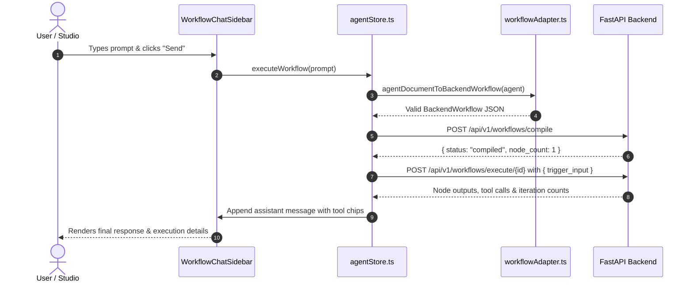

<p align="center">
  <h1 align="center">🦦 Otter Frontend Studio</h1>
  <p align="center"><b>Visual AI Agent Studio, Workflow Editor & Interactive Chat Interface</b></p>
</p>

<p align="center">
  
  
  
  
  
  
</p>

---

## Overview

The **Otter Frontend Studio** is a Next.js 16 web application designed for visually constructing, configuring, testing, and chatting with autonomous AI workflows. It provides a visual 3-stage pipeline editor, dynamic schema-driven tool configuration dialogs, and a real-time chat sidebar that compiles and executes workflows against the Otter FastAPI backend engine.

---

## ✨ Key Features

### 1. 3-Stage Pipeline Architecture
Workflows are composed in an intuitive 3-stage layout:
- **Trigger Stage**: Select how the workflow is activated (`chat`, `webhook`, `telegram`).
- **Agent Stage**: Configure LLM models (Groq Qwen 2.5/3.8, Compound, OpenAI GPT-4o), system instructions, temperature, iteration limits, and attach multiple backend integration tools.
- **Output Stage**: Define downstream destination actions matching the trigger (`chat_response`, `webhook_response`, `telegram_response`).

### 2. Workflow Chat Sidebar (`WorkflowChatSidebar`)
- Chat directly with your compiled agent workflow in real-time.
- Automatically compiles the current graph on the backend before executing user queries.
- Displays inline tool execution badges (e.g. `currency_converter`, `node_http_request`, `resend_email`), function call arguments, return data, and reasoning iteration counts.
- Maintains interactive chat history and execution status indicators.

### 3. Dynamic Schema-Driven Tool Modals
- **Add Tool Modal (`AddToolModal`)**: Dynamically queries backend tools via `GET /api/v1/agent/tools` or falls back to standard registered tools.
- **Tool Config Modal (`ToolConfigModal`)**: Automatically generates custom input forms based on tool parameter schemas (text, textarea, key-value headers, dropdowns, secure credential fields).
- **Supported Integrations**:
  - `discord_webhook`: Instant zero-auth channel messaging & rich embed cards for Discord.
  - `notion_page`: Structured Notion page and database row creation with automatic Markdown-to-Blocks translation.
  - `web_search`: Zero-auth live web search powered by DuckDuckGo.
  - `jina_reader`: Read and convert any webpage URL to clean Markdown via Jina AI Reader (`r.jina.ai`).
  - `node_http_request`: Custom REST calls with header templating and method selection.
  - `currency_converter`: Live ECB foreign exchange and CoinGecko crypto conversions.
  - `resend_email`: Resend email API integration with user email routing ("mail me").
  - `get_weather`: Meteorological report retrieval.
  - `json_transform`: JSON key filtering and formatting.

### 4. Real-Time State & Adapter Engine
- **Zustand Store (`store/agentStore.ts`)**: Central reactive state handling active agent documents, dirty state tracking, modal views, chat sidebar state, and execution history.
- **Workflow Adapter (`lib/workflowAdapter.ts`)**: Seamlessly translates frontend component state into clean FastAPI Directed Acyclic Graph (DAG) payloads ready for compilation.

---

## 🏗️ Project Structure

```
front-automation/
├── app/
├── app/
│   ├── [docId]/                 # Document-specific agent studio route
│   ├── docs/                    # Interactive documentation browser
│   ├── favicon.ico              # Application favicon
│   ├── globals.css              # Global styles & Tailwind CSS v4 imports
│   ├── layout.tsx               # Root application layout
│   └── page.tsx                 # Main studio & landing page
├── components/
│   ├── AddToolModal.tsx         # Modal for selecting new tools to attach
│   ├── AgentStudio.tsx          # Main 3-stage visual agent editor canvas
│   ├── OtterLogo.tsx            # SVG branding logo
│   ├── ToolConfigModal.tsx      # Schema-driven configuration modal for tools
│   ├── WorkflowActiveToggle.tsx # Quick activate / pause toggle
│   ├── WorkflowChatSidebar.tsx  # Real-time chat & tool execution sidebar
│   ├── InteractiveWorkflowEditor.tsx # Interactive visual workflow node graph
│   ├── Navbar.tsx               # Studio navigation header
│   └── ...                      # Landing & showcase section components
├── lib/
│   ├── api.ts                   # REST client for Otter FastAPI backend
│   └── workflowAdapter.ts       # UI state <-> Backend DAG converter
├── store/
│   └── agentStore.ts            # Central Zustand state store
├── public/                      # Static assets & icons
├── next.config.ts               # Next.js configuration
├── package.json                 # Project dependencies & scripts
└── tsconfig.json                # TypeScript compiler configuration
```

---

## 🚀 Getting Started

### Prerequisites

- **Node.js**: `v18.18+` or `v20+` (Node 20+ recommended)
- **npm**, **yarn**, **pnpm**, or **bun**
- **Otter Backend**: Running on `http://localhost:8000` (see `AIAutomationWorkflow/backend`)

### 1. Installation

```bash
cd front-automation
npm install
```

### 2. Environment Configuration

Create a `.env.local` file in `front-automation/`:

```env
# URL to the running Otter FastAPI backend service
NEXT_PUBLIC_BACKEND_URL=http://localhost:8000
```

If omitted, `DEFAULT_BACKEND_URL` defaults to `http://localhost:8000`.

### 3. Running Development Server

```bash
npm run dev
```

Open [http://localhost:3000](http://localhost:3000) in your browser.

### 4. Building for Production

```bash
# Type check and build Next.js application
npm run build

# Start production server
npm run start
```

---

## 🔄 Backend Integration Flow

When testing or executing a workflow from the frontend:



---

## 🛠️ Configuration & Customization

### Adding Supported Models
Models displayed in the agent configuration dropdown can be customized in `store/agentStore.ts` via the `AVAILABLE_MODELS` array:
```typescript
export const AVAILABLE_MODELS = [
  "groq/compound",
  "qwen/qwen3.8-27b",
  "openai/gpt-oss-120b",
  "whisper-large-v3-turbo",
  // ...
];
```

### Adding New Tools to the UI
The frontend automatically queries `GET /api/v1/agent/tools`. When a new tool is registered in the backend's `TOOL_CLASS_REGISTRY` and `TOOL_METADATA` (see [CUSTOM_TOOLS.md](file:///home/yeasir/Projeccts/Enterprise/AIAutomationWorkflow/backend/docs/CUSTOM_TOOLS.md)), the `AddToolModal` and `ToolConfigModal` render it automatically without manual frontend code changes!

---

## 📄 License

This project is licensed under the **MIT License**.
